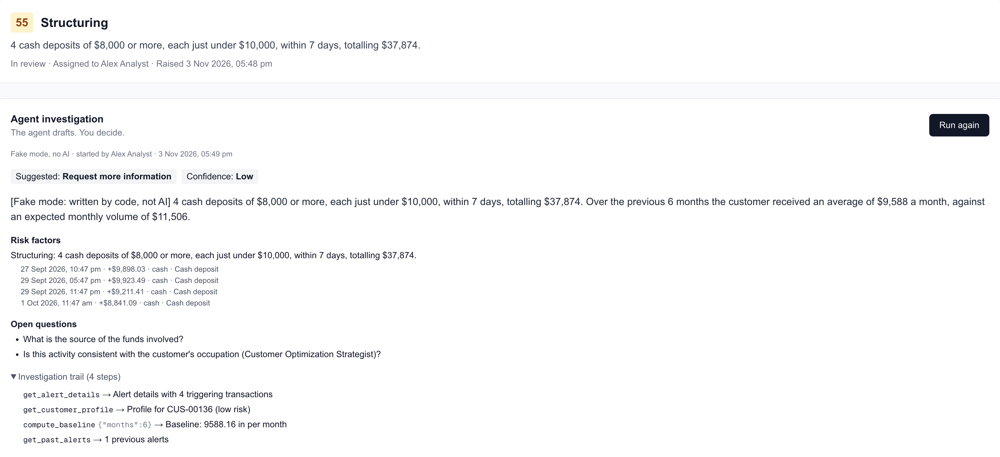
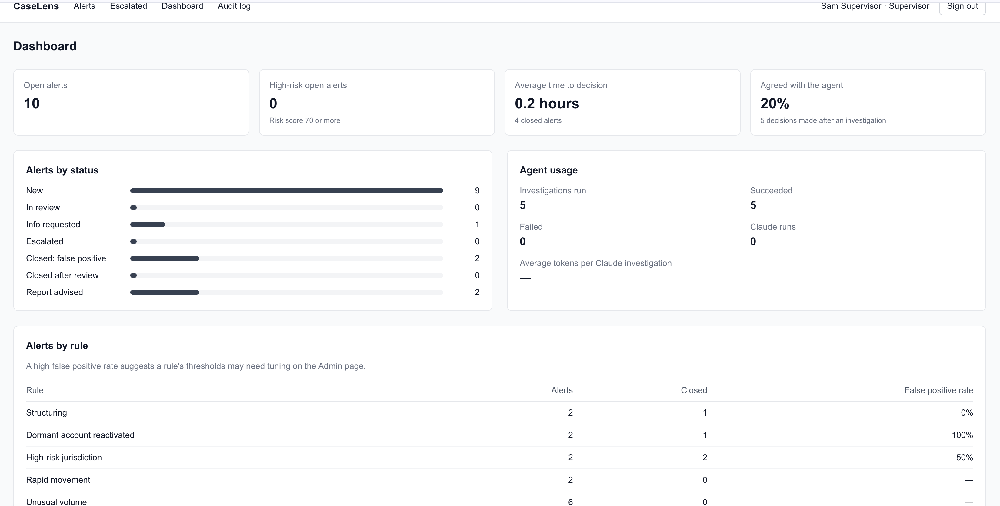
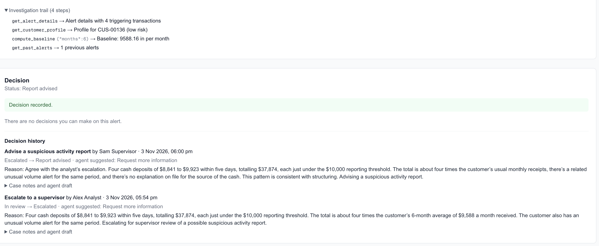
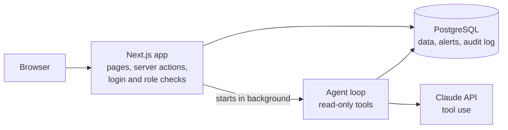

# CaseLens: AML Alert Investigation Assistant

[](https://github.com/pravijad/aml-investigation-assistant/actions/workflows/ci.yml)

Banks raise anti-money-laundering (AML) alerts on suspicious transactions, and analysts spend a long time gathering evidence for each one. CaseLens raises alerts from transparent rules, then lets an AI agent gather the evidence with read-only tools and draft a case summary in which **every claim links to a real transaction**. A human analyst always makes the decision, and every step is audited.

> **Portfolio project. Synthetic data only.** CaseLens uses generated, fictional customers and transactions. It isn't connected to any bank and doesn't file reports with regulators.



## Features

**For analysts**

- An alert queue sorted by risk score, with filters for status, rule and "assigned to me"
- Alert pages showing the triggering transactions highlighted in a timeline, the customer profile and past alerts
- **Investigate**: an AI agent gathers evidence and drafts a summary, risk factors, mitigating factors, open questions and a suggested action, with the transactions behind each claim listed underneath
- Decisions with a required reason: close as a false positive, escalate, or request more information

**For supervisors**

- A queue of escalated alerts, and final decisions: close after review, advise a suspicious activity report, or return to the analyst
- A dashboard with open and high-risk alerts, time to decision, false positive rate per rule, agent usage, and how often analysts agreed with the agent
- A searchable audit log with CSV export

**For admins**

- Five configurable detection rules: structuring, rapid movement, high-risk jurisdiction, unusual volume and dormant account reactivation
- Rules can be switched on or off and their thresholds edited, with every change validated and audited



## How the agent works

When an analyst clicks **Investigate**, a background job runs an agent loop using the Claude API with tool use:

1. The agent receives the alert ID and a fixed set of tools.
2. It calls tools to gather evidence: alert details, customer profile, transactions in a date range, a 6-month baseline, past alerts, and whether counterparties appear in other alerts.
3. It submits a structured result, which the app validates before showing it to the analyst.

**Guardrails**

- **Read-only tools, scoped to one customer.** The agent never touches the database directly.
- **Evidence checking.** Every cited transaction ID must have been returned by a tool. Made-up IDs are rejected, and the agent gets one chance to fix them.
- **Structured output** validated with Zod.
- **Limits** on tool calls, turns and tokens per investigation.
- **Prompt injection defence.** Tool results are treated as data, and the instructions forbid following commands found inside them.
- **Human in the loop.** The agent only suggests. Only a person can change an alert's status.
- **Traceability.** The model, instructions version, every tool call and token usage are stored with each investigation, and each decision keeps an unchanged copy of the agent's draft beside the analyst's final notes.

Without an API key, the agent runs in **fake mode**: it calls the same real tools, but the draft is written by code. This keeps development and CI free.



## Architecture



## Tech stack

| Area | Technology |
| --- | --- |
| App | Next.js 16 (App Router), React, TypeScript |
| Styling | Tailwind CSS |
| Database | PostgreSQL with Prisma 6 |
| Validation | Zod |
| Authentication | bcrypt password hashing, signed JWT session in an HTTP-only cookie (jose), role-based access |
| AI agent | Anthropic SDK (Claude) with tool use |
| Testing | Vitest |
| CI | GitHub Actions: lint, type check, unit tests, migrations, seed and build on every pull request |

## Getting started

**Prerequisites:** Node.js 20 or later, and PostgreSQL.

1. **Install dependencies**

   ```bash
   npm install
   ```

2. **Create the database**

   ```bash
   createdb aml_assistant
   ```

3. **Configure environment variables**

   ```bash
   cp .env.example .env
   ```

   Set `DATABASE_URL` to your database, and set `AUTH_SECRET` to a long random string, which you can generate with `openssl rand -base64 32`. `ANTHROPIC_API_KEY` is optional; without it, the agent runs in fake mode.

4. **Create the tables and load synthetic data**

   ```bash
   npx prisma migrate dev
   npm run db:seed
   ```

   This creates 200 customers, about 35,000 transactions, suspicious patterns planted in 10 customers, the detection rules and three demo users.

5. **Run the app**

   ```bash
   npm run dev
   ```

   Open `http://localhost:3000`.

6. **Raise alerts.** Sign in as the admin, open **Admin**, and click **Run rules now**.

### Demo accounts

All three use the password `Password123!`. They're for local development only.

| Email | Role |
| --- | --- |
| `analyst@caselens.test` | Analyst |
| `supervisor@caselens.test` | Supervisor |
| `admin@caselens.test` | Admin |

## Testing

```bash
npm test             # unit tests for the detection rules and risk score
npm run lint
npx tsc --noEmit
```

The CI pipeline runs all of these on every pull request, and also builds a fresh database from the migrations and seed. The `main` branch is protected, so changes merge only through pull requests with passing checks.

## Project structure

```
prisma/              Schema, migrations and seed script
src/app/             Pages, server actions and API routes
src/agent/           Agent tools, instructions, loop, validation and fake mode
src/rules/           Detection rules, risk score and rules runner
src/lib/             Database client, authentication, audit and formatting helpers
tests/               Unit tests
.github/workflows/   CI pipeline
```

## Roadmap

- Deploy to Azure with Terraform: App Service, PostgreSQL Flexible Server, Key Vault and managed identity
- A deployment pipeline with OIDC login and an approval gate
- End-to-end tests with Playwright
- An evaluation set of sample alerts, to measure the quality of the agent's drafts over time

## Disclaimer

This is a learning and portfolio project. It uses synthetic data only and isn't intended for production use or real compliance decisions.
